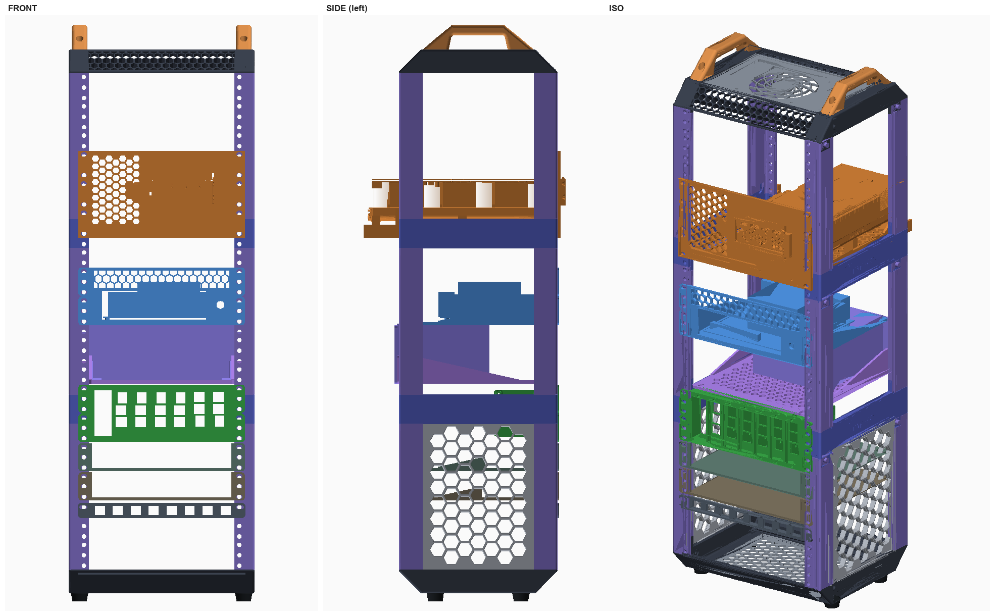

# Lab Rax 17U — home AI rig

A 17U [Lab Rax](https://the-diy-life.com/introducing-lab-rax-a-3d-printable-modular-10-rack-system/) 10" rack
(3 × 5U sections + 2 × upgraded 1U extensions), modelled from the real CAD and the parts actually printed.

**Open the whole thing in one file:** [`assembly/out/rack_assembly_17U.3mf`](assembly/out/rack_assembly_17U.3mf)
— 20 named, coloured parts in rack coordinates (mm, z = 0 at the bottom of the feet). Opens in OrcaSlicer,
Bambu Studio, Fusion, PrusaSlicer or Windows 3D Viewer.



## Stack (bottom up)

| Position | Module | Notes |
|---|---|---|
| 5 holes | empty | |
| 0.5U | keystone blank (`keystone-blank-1_2u-10i-rm`) | mounted flipped, from the 6th hole, then +1 hole |
| 1U | open shelf `tpe_bg_380_1u_open_shelf_solid` | |
| 1U | open shelf `gs108t_1u_open_shelf_solid_` | |
| 2U | `2U+7+SBC+Holder` + Pi holders | slot 1 empty, 2–5 Pi 4, 6–7 Pi 5 / Pi 3; holders bolt to the front face on the slot hole pairs (29.67 pitch) |
| 2U, rear posts | `ATX+PSU+2U+Mount` + ATX PSU (RM1000e, 150 × 86 × 140) on a PETG `obj_1_1U Open Shelf` | PSU bolts to the ATX screw pattern; shelf ears share the mount's holes |
| 2U | `2U Mini ITX Computer Shelf` + generic mini-ITX board | on mini-ITX holes C/F/H/J, 6.35 standoffs, AXP90-X53 |
| 1U | empty | |
| 3U | our GPU shelf + faceplate + RTX 3090 Ti FTW3 | `gpu_shelf/` |

Everything except the GPU sits one hole above the U grid (two of a panel's three holes still line up).
Known: the PSU resting on the open-shelf floor overlaps the mini-ITX shelf floor by ~1.1 mm in CAD.

## Frame — how it goes together (from the hole positions in the real STLs)

* **Top Edge** = the post's L-profile turned on its side, directly under / over each post section.
  Its wall-top groove takes the side panel (222.25 + 2 × 2.95 = 228.15); its ledge-tip groove the
  base/top panel (228 / 2 = 141 − 27).
* **Horizontal Edge** = an L-angle printed at 45°; each end pad's two holes (31.82 apart) bridge the
  post insert (22.5, +10) and the Top Edge insert (45, −12.5) at 45°. Lands flush front and bottom.
* **1U extension** = full-depth side rail with its own three EIA holes on the post's 22.86 column.
* **Side panels** (`labrax-hws`, 2 printed) slide into the 1.2–4.6 mm slot in the posts / Top Edges / extensions.
* Feet and handles screw into the Top Edge ledge inserts.

## Layout

```
assembly/        rack_layout.py (generator), _hardware.py (PSU + mini-ITX board), _export_3mf.py,
                 rack.html + serve.py (three.js viewer: python serve.py -> http://127.0.0.1:8772/rack.html),
                 out/ (every placed part as STL, LAYOUT.json, rack_assembly_17U.3mf), renders/,
                 analysis helpers (_realbores, _cbores, _sect, _partview, _corner, _clash3)
cad/labrax/      the real Lab Rax CAD used (STL/3MF/STEP), incl. from_nobby/ (copied from nobby's
                 D:\Downloads\08_3D_Printing\LabRax)
cad/spec_labrax, cad/gpu_ref_labrax   reference copies the scripts also read
gpu_shelf/       the custom 3U GPU shelf: gpu_shelf.py (CadQuery), print/ STLs + STEP, viewer.html
```

`rack_layout.py` reads the CAD from its original locations on the work laptop
(`~/Downloads/CAD/LabRax`, `workspace/cad/...`); repoint `LABRAX` / `SRC` to `cad/` to run it from here.

## Licences

The Lab Rax parts and the community modules are other people's designs (Michael Klements / The DIY Life
and MakerWorld / Printables authors). This repo is private for that reason — check each model's licence
before making it public.
